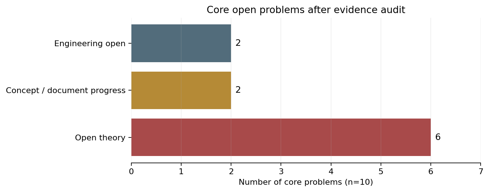

# TOE-SYLVA 十个核心开放问题：证据裁决与未竟工作

**审计日期**：2026-11-10。范围是 `papers/OPEN_PROBLEMS.md` 的 O1–O10 及其链接文档、治理登记、CI 和外部原始来源。原始草案保留作历史证据，本轮不以“已解决”自我宣告代替证明。

## 直接结论

旧表“8/10 已解决”不能成立。逐项复核后为：**6 项理论开放、2 项文档或概念进展、2 项工程未决**。没有一项应当继续沿用旧表的完成状态；O4 与 O9 有实质组织价值，但也不等于 TOE 主方程或最小公理集已经得证。

**图1定位**：总述之后。图中 6 项理论开放、2 项概念进展、2 项工程未决均由本次逐条文档与证据映射生成，不是主观评分。

## 十项状态总表

| 编号 | 主题 | 本轮状态 | 是否可视为新方向 | 未竟工作的下一步 |
|---|---|---|---|---|
| O1 | 精细结构常数的独立推导 | **未解决（CLAIM）** | 仍是高风险理论研究方向，不是已经闭合的常数导出。 | 先给出不引用 α 的 n_CS 定义域和独立计算，再给出 Dirac 谱或 CY 实例、全部系数和盲登记；未完成前不得写“已解决”或“概率压到不可能”。 |
| O2 | 非 BPS 黑洞的熵与 DT 配分函数 | **未解决（CLAIM）** | 可形成明确的非 BPS 精确算例方向，但现有三条路径都不是证明。 | 选定一个可精确计算的非 BPS 黑洞模型，分别定义并计算宏观熵与 DT 侧对象，检验修正项；在此之前撤销“推广完成”。 |
| O3 | 暗能量全局谱 | **未解决（CONJECTURE）** | 可转为背景与扰动联合检验的宇宙学研究方向，现有文档尚未给出全局谱。 | 先固定 L_max 或取消数量级宣称，给出 w(z)、背景膨胀和扰动可观测量的明确模型，并与 DESI、CMB、超新星在共同似然下比较。 |
| O4 | 公理依赖 DAG 与最小初设 | **文档草案完成，理论未闭合** | 可成为机器可读的公理治理项目，但“最小 5 公理”尚未证明。 | 建立全量机器可读节点、边、来源和证明状态，检查遗漏、循环和隐藏依赖；只有验证最小性后才能称 DAG 完成。 |
| O5 | NCG 谱三元组与 TOE 主方程 | **未解决（CONJECTURE）** | 可研究有限维精确对应，现有 eta-DT 等价仍缺核心定理。 | 先在一个有限维、显式谱三元组中计算 eta 与目标 DT 对象，给出定理级映射和成立条件；不能用已有 APS／Connes 定理的名称替代新映射证明。 |
| O6 | p-adic Adelic 统一 | **未解决（CONJECTURE）** | 可研究 p-adic 模空间与局部配分函数，完整 Adelic 乘积仍缺定义和收敛。 | 先构造一个 p-adic 局部 DT 实例并证明可比性，再分析乘积收敛；在定义和收敛未完成前，不把 Adelic 形式写成 TOE 的完整定义。 |
| O7 | Agda 实数与 Hilbert 空间形式化 | **工程未解决** | 是真实的证明工程方向，不是已经完成的理论成果。 | 按依赖顺序替换 131 个 postulate 并保存真实编译与公理审计；不能因其他 Lean 模块成功就把 Agda 侧标为完成。 |
| O8 | 全库 Lake 构建与 CI | **工程未解决** | 需要可扩展的核心构建矩阵和仓库瘦身，现有四目标构建是局部进展。 | 保留四目标验收，增加受控核心矩阵、缓存和文件瘦身，并公开每次实际运行；只有目标范围写清后才能升级状态。 |
| O9 | 辛几何与 TOE 主方程 | **结构启发，TOE 等价未证** | 辛结构可作为研究 GW／DT 前置条件的方向，但还没有证明 TOE 主方程。 | 分别证明离散辛形式、闭性、非退化与连续极限，再审查从 DT 到具体黑洞熵的映射；把“前置条件成立”与“TOE 等式成立”分开。 |
| O10 | 费米子质量谱 | **未解决（只有定性层级）** | 可转为盲登记质量比预言方向，现有文档没有参数内生的质量谱。 | 冻结一个未参与拟合的质量比或 CKM 数值及不确定度，说明参数来源和盲裁决窗口；若给不出，应保持“定性启发”而非“质量谱完成”。 |

## 外部基线修正

- CODATA 2022 的精细结构常数倒数已经更新，旧稿仍使用 2018 数值；所有误差和“百万分之一”表述必须按新基线重算。[NIST CODATA](kimi-cite://web?url=https%3A%2F%2Fphysics.nist.gov%2Fcgi-bin%2Fcuu%2FValue%3Falphinv%257Csearch_for%3Dalphainv "citation")
- Pardon 的原文处理曲线枚举对应，不能写成对任意 BPS 黑洞熵的证明。[Pardon 原文](kimi-cite://web?url=https%3A%2F%2Fwww.math.stonybrook.edu%2F~jpardon%2Fmanuscripts%2F19_mnopcy.pdf "citation")
- DESI DR2 联合数据对演化暗能量有偏好，同时仍需警惕模型依赖和历史张力消退；旧稿“目前无演化迹象”应撤回，而不是反向宣称演化已确定。[DESI DR2 讲解](kimi-cite://web?url=https%3A%2F%2Findico.cern.ch%2Fevent%2F1515773%2Fcontributions%2F6399007%2Fattachments%2F3062706%2F5416284%2FFontRibera_EUCAPT.pdf "citation")
- 光滑五次三维簇的欧拉示性数为 −200，旧稿用于挑选 n_CS 的 −100 对应关系不成立。[Macaulay2](kimi-cite://web?url=https%3A%2F%2Fmacaulay2.com%2Fdoc%2FMacaulay2-1.21%2Fshare%2Fdoc%2FMacaulay2%2FMacaulay2Doc%2Fhtml%2F_euler_lp__Projective__Variety_rp.html "citation")

## 逐项证据与未竟工作

### O1：精细结构常数的独立推导

**裁决**：未解决（CLAIM）。仍是高风险理论研究方向，不是已经闭合的常数导出。

- 文档自己否认数学证明，却在后文把三链等价和极强反巧合措辞写成结论。 [101_fine_structure_constant_derivation](kimi-cite://md-line?path=C%3A%5CUsers%5C%E4%B8%80%E6%A2%A6%5CDocuments%5Ckimi%5Cworkspace%5Ctoe-sylva-audit%5Cframework%5C101_fine_structure_constant_derivation.md&line=21&text=%E6%9C%AC%E6%96%87%E4%B8%8D%E8%87%AA%E7%A7%B0%E6%95%B0%E5%AD%A6%E8%AF%81%E6%98%8E "citation")，第 21 行。
- 现行治理登记没有升级为 THEOREM。 [proof_status](kimi-cite://md-line?path=C%3A%5CUsers%5C%E4%B8%80%E6%A2%A6%5CDocuments%5Ckimi%5Cworkspace%5Ctoe-sylva-audit%5Cframework%5Cproof_status.md&line=26&text=%E5%BD%93%E5%89%8D%E7%8A%B6%E6%80%81%2A%2A%3A%20CLAIM "citation")，第 26 行。
- 五次簇的标准欧拉示性数并不是该文档用于挑值的 −100。 [101_fine_structure_constant_derivation](kimi-cite://md-line?path=C%3A%5CUsers%5C%E4%B8%80%E6%A2%A6%5CDocuments%5Ckimi%5Cworkspace%5Ctoe-sylva-audit%5Cframework%5C101_fine_structure_constant_derivation.md&line=57&text=%CF%87%28X%29%20%3D%20-100 "citation")，第 57 行。
- 外部边界：2022 CODATA 为 137.035999177(21)，旧稿需要更新实验基线和误差预算。 [NIST CODATA](kimi-cite://web?url=https%3A%2F%2Fphysics.nist.gov%2Fcgi-bin%2Fcuu%2FValue%3Falphinv%257Csearch_for%3Dalphainv "citation")
- 外部边界：光滑五次三维簇的欧拉示性数为 −200。 [Macaulay2](kimi-cite://web?url=https%3A%2F%2Fmacaulay2.com%2Fdoc%2FMacaulay2-1.21%2Fshare%2Fdoc%2FMacaulay2%2FMacaulay2Doc%2Fhtml%2F_euler_lp__Projective__Variety_rp.html "citation")

**未竟工作**：先给出不引用 α 的 n_CS 定义域和独立计算，再给出 Dirac 谱或 CY 实例、全部系数和盲登记；未完成前不得写“已解决”或“概率压到不可能”。

### O2：非 BPS 黑洞的熵与 DT 配分函数

**裁决**：未解决（CLAIM）。可形成明确的非 BPS 精确算例方向，但现有三条路径都不是证明。

- 把 MNOP 曲线枚举对应写成了对任意 BPS 黑洞熵的证明，归属过宽。 [103_non_bps_black_hole_generalization](kimi-cite://md-line?path=C%3A%5CUsers%5C%E4%B8%80%E6%A2%A6%5CDocuments%5Ckimi%5Cworkspace%5Ctoe-sylva-audit%5Cframework%5C103_non_bps_black_hole_generalization.md&line=15&text=%E5%9C%A8%20Pardon%20%282023%29%20%E7%9A%84%E4%B8%A5%E6%A0%BC%E8%AF%81%E6%98%8E%E4%B8%8B%E5%AF%B9%20BPS%20%E9%BB%91%E6%B4%9E%E6%88%90%E7%AB%8B "citation")，第 15 行。
- 解析延拓明确只是推测性骨架，没有给出实际配分函数或一个非 BPS 算例。 [103_non_bps_black_hole_generalization](kimi-cite://md-line?path=C%3A%5CUsers%5C%E4%B8%80%E6%A2%A6%5CDocuments%5Ckimi%5Cworkspace%5Ctoe-sylva-audit%5Cframework%5C103_non_bps_black_hole_generalization.md&line=67&text=%E5%AE%9A%E7%90%86%20103.1 "citation")，第 67 行。
- 1/4 与 3/4 熵分解由 Postulate 直接给出，没有独立微观计数。 [103_non_bps_black_hole_generalization](kimi-cite://md-line?path=C%3A%5CUsers%5C%E4%B8%80%E6%A2%A6%5CDocuments%5Ckimi%5Cworkspace%5Ctoe-sylva-audit%5Cframework%5C103_non_bps_black_hole_generalization.md&line=91&text=%5Cfrac%7B3A%7D%7B16G%7D "citation")，第 91 行。
- 外部边界：MNOP 处理 GW 与 DT 曲线枚举对应，不能替代具体黑洞熵模型的证明。 [Pardon 原文](kimi-cite://web?url=https%3A%2F%2Fwww.math.stonybrook.edu%2F~jpardon%2Fmanuscripts%2F19_mnopcy.pdf "citation")

**未竟工作**：选定一个可精确计算的非 BPS 黑洞模型，分别定义并计算宏观熵与 DT 侧对象，检验修正项；在此之前撤销“推广完成”。

### O3：暗能量全局谱

**裁决**：未解决（CONJECTURE）。可转为背景与扰动联合检验的宇宙学研究方向，现有文档尚未给出全局谱。

- 首个真空极限公式含有 logZ，在 Z→1 时趋于零，不能凭该式得到正 Λ。 [102_dark_energy_toe_bridge](kimi-cite://md-line?path=C%3A%5CUsers%5C%E4%B8%80%E6%A2%A6%5CDocuments%5Ckimi%5Cworkspace%5Ctoe-sylva-audit%5Cframework%5C102_dark_energy_toe_bridge.md&line=59&text=S_%7B%5Ctext%7BBH%7D%7D%20-%20%5Clog%20Z_%7B%5Ctext%7BDT%7D%7D "citation")，第 59 行。
- 决定 10^-120 数量级的关键层数仍自由。 [102_dark_energy_toe_bridge](kimi-cite://md-line?path=C%3A%5CUsers%5C%E4%B8%80%E6%A2%A6%5CDocuments%5Ckimi%5Cworkspace%5Ctoe-sylva-audit%5Cframework%5C102_dark_energy_toe_bridge.md&line=81&text=CNF%20%E7%9B%AE%E5%89%8D%E6%B2%A1%E6%9C%89%E4%BB%8E%E7%AC%AC%E4%B8%80%E5%8E%9F%E7%90%86%E7%A1%AE%E5%AE%9A "citation")，第 81 行。
- 该“无演化迹象”表述已落后于 DESI DR2 及后续联合分析。 [102_dark_energy_toe_bridge](kimi-cite://md-line?path=C%3A%5CUsers%5C%E4%B8%80%E6%A2%A6%5CDocuments%5Ckimi%5Cworkspace%5Ctoe-sylva-audit%5Cframework%5C102_dark_energy_toe_bridge.md&line=127&text=%E7%9B%AE%E5%89%8D%E6%97%A0%EF%BC%88w%20%E4%B8%8D%E5%81%8F%E7%A6%BB%20-1%EF%BC%89 "citation")，第 127 行。
- 外部边界：联合数据对演化暗能量有偏好，但作者同时提醒历史张力可能消失，不能把任何一边写成定论。 [DESI DR2 讲解](kimi-cite://web?url=https%3A%2F%2Findico.cern.ch%2Fevent%2F1515773%2Fcontributions%2F6399007%2Fattachments%2F3062706%2F5416284%2FFontRibera_EUCAPT.pdf "citation")

**未竟工作**：先固定 L_max 或取消数量级宣称，给出 w(z)、背景膨胀和扰动可观测量的明确模型，并与 DESI、CMB、超新星在共同似然下比较。

### O4：公理依赖 DAG 与最小初设

**裁决**：文档草案完成，理论未闭合。可成为机器可读的公理治理项目，但“最小 5 公理”尚未证明。

- 输入集合尚未完整标准化，因此不能据此证明 DAG 完备。 [99_postulate_dependency_dag](kimi-cite://md-line?path=C%3A%5CUsers%5C%E4%B8%80%E6%A2%A6%5CDocuments%5Ckimi%5Cworkspace%5Ctoe-sylva-audit%5Cframework%5C99_postulate_dependency_dag.md&line=34&text=52%20%E8%BF%99%E4%B8%AA%E6%95%B0%E5%AD%97%E6%98%AF%E7%B2%97%E7%95%A5%E4%BC%B0%E8%AE%A1 "citation")，第 34 行。
- 最小性结论没有独立推导或机器验证支撑。 [99_postulate_dependency_dag](kimi-cite://md-line?path=C%3A%5CUsers%5C%E4%B8%80%E6%A2%A6%5CDocuments%5Ckimi%5Cworkspace%5Ctoe-sylva-audit%5Cframework%5C99_postulate_dependency_dag.md&line=59&text=CNF%20%E7%9A%84%E6%9C%80%E5%B0%8F%E5%85%AC%E7%90%86%E9%9B%86 "citation")，第 59 行。

**未竟工作**：建立全量机器可读节点、边、来源和证明状态，检查遗漏、循环和隐藏依赖；只有验证最小性后才能称 DAG 完成。

### O5：NCG 谱三元组与 TOE 主方程

**裁决**：未解决（CONJECTURE）。可研究有限维精确对应，现有 eta-DT 等价仍缺核心定理。

- eta-DT 对应被作者明确标为未完全证明。 [97_noncommutative_geometry_to_toe_bridge](kimi-cite://md-line?path=C%3A%5CUsers%5C%E4%B8%80%E6%A2%A6%5CDocuments%5Ckimi%5Cworkspace%5Ctoe-sylva-audit%5Cframework%5C97_noncommutative_geometry_to_toe_bridge.md&line=99&text=%E5%B0%9A%E6%9C%AA%E4%BB%A5%E5%AE%8C%E5%85%A8%E7%9A%84%E4%B8%A5%E6%A0%BC%E6%80%A7%E8%A2%AB%E8%AF%81%E6%98%8E "citation")，第 99 行。
- 核心桥梁仍是开放问题，不能称映射完成。 [97_noncommutative_geometry_to_toe_bridge](kimi-cite://md-line?path=C%3A%5CUsers%5C%E4%B8%80%E6%A2%A6%5CDocuments%5Ckimi%5Cworkspace%5Ctoe-sylva-audit%5Cframework%5C97_noncommutative_geometry_to_toe_bridge.md&line=272&text=%E5%AE%8C%E5%85%A8%E4%B8%A5%E6%A0%BC%E7%9A%84%20infinite-dimensional%20%E7%89%88%E6%9C%AC%E6%9C%AA%E8%AF%81 "citation")，第 272 行。

**未竟工作**：先在一个有限维、显式谱三元组中计算 eta 与目标 DT 对象，给出定理级映射和成立条件；不能用已有 APS／Connes 定理的名称替代新映射证明。

### O6：p-adic Adelic 统一

**裁决**：未解决（CONJECTURE）。可研究 p-adic 模空间与局部配分函数，完整 Adelic 乘积仍缺定义和收敛。

- 被乘对象本身尚未严格构造。 [100_padic_adelic_to_toe_bridge](kimi-cite://md-line?path=C%3A%5CUsers%5C%E4%B8%80%E6%A2%A6%5CDocuments%5Ckimi%5Cworkspace%5Ctoe-sylva-audit%5Cframework%5C100_padic_adelic_to_toe_bridge.md&line=71&text=p-adic%20%E8%99%9A%E6%8B%9F%E5%9F%BA%E6%9C%AC%E7%B1%BB%E7%9A%84%E4%B8%A5%E6%A0%BC%E6%95%B0%E5%AD%A6%E6%9E%84%E9%80%A0%E5%B0%9A%E6%9C%AA%E5%9C%A8%E6%96%87%E7%8C%AE%E4%B8%AD%E5%AE%8C%E6%95%B4%E7%BB%99%E5%87%BA "citation")，第 71 行。
- 截断和衰减仍属未验证假设。 [100_padic_adelic_to_toe_bridge](kimi-cite://md-line?path=C%3A%5CUsers%5C%E4%B8%80%E6%A2%A6%5CDocuments%5Ckimi%5Cworkspace%5Ctoe-sylva-audit%5Cframework%5C100_padic_adelic_to_toe_bridge.md&line=207&text=Adelic%20%E4%B9%98%E7%A7%AF%E5%9C%A8%20p%3E137%20%E5%A4%84%E7%9A%84%E8%A1%B0%E5%87%8F%E7%8E%87%E4%B8%A5%E6%A0%BC%E8%AF%81%E6%98%8E "citation")，第 207 行。

**未竟工作**：先构造一个 p-adic 局部 DT 实例并证明可比性，再分析乘积收敛；在定义和收敛未完成前，不把 Adelic 形式写成 TOE 的完整定义。

### O7：Agda 实数与 Hilbert 空间形式化

**裁决**：工程未解决。是真实的证明工程方向，不是已经完成的理论成果。

- 实数、完备性、量子范畴和谱模块仍有 postulate。 [proof_status](kimi-cite://md-line?path=C%3A%5CUsers%5C%E4%B8%80%E6%A2%A6%5CDocuments%5Ckimi%5Cworkspace%5Ctoe-sylva-audit%5Cframework%5Cproof_status.md&line=85&text=Sylva.Real.Cauchy "citation")，第 85 行。
- 现行实测口径为 7 文件、25 顶层块、131 个 postulate 名字声明。 [p0_reconciliation_report](kimi-cite://md-line?path=C%3A%5CUsers%5C%E4%B8%80%E6%A2%A6%5CDocuments%5Ckimi%5Cworkspace%5Ctoe-sylva-audit%5Cframework%5Cp0_reconciliation_report.md&line=44&text=131%20%E4%B8%AA "citation")，第 44 行。

**未竟工作**：按依赖顺序替换 131 个 postulate 并保存真实编译与公理审计；不能因其他 Lean 模块成功就把 Agda 侧标为完成。

### O8：全库 Lake 构建与 CI

**裁决**：工程未解决。需要可扩展的核心构建矩阵和仓库瘦身，现有四目标构建是局部进展。

- CI 明确不是全库通过。 [ci](kimi-cite://md-line?path=C%3A%5CUsers%5C%E4%B8%80%E6%A2%A6%5CDocuments%5Ckimi%5Cworkspace%5Ctoe-sylva-audit%5C.github%5Cworkflows%5Cci.yml&line=57&text=%E5%B7%B2%E6%A0%B8%E5%AE%9A%20Lean%20%E6%A0%B8%E5%BF%83%E7%9A%84%E7%9C%9F%E5%AE%9E%E6%9E%84%E5%BB%BA%EF%BC%88%E4%B8%8D%E6%98%AF%E5%85%A8%E5%BA%93%E9%80%9A%E8%BF%87%E5%A3%B0%E6%98%8E%EF%BC%89 "citation")，第 57 行。
- 当前只构建四个已核定目标，不能登记全库 Lake 已完成。 [ci](kimi-cite://md-line?path=C%3A%5CUsers%5C%E4%B8%80%E6%A2%A6%5CDocuments%5Ckimi%5Cworkspace%5Ctoe-sylva-audit%5C.github%5Cworkflows%5Cci.yml&line=71&text=SYLVA_CHSHCore%20SYLVA_CrossModuleTheorems%20PhysicalChemistry.ReactionNetwork%20SYLVA_Causality "citation")，第 71 行。

**未竟工作**：保留四目标验收，增加受控核心矩阵、缓存和文件瘦身，并公开每次实际运行；只有目标范围写清后才能升级状态。

### O9：辛几何与 TOE 主方程

**裁决**：结构启发，TOE 等价未证。辛结构可作为研究 GW／DT 前置条件的方向，但还没有证明 TOE 主方程。

- 流程图从 MNOP 对应直接跳到 S_BH=logZ_DT，最后一步没有独立证明。 [96_symplectic_geometry_to_toe_bridge](kimi-cite://md-line?path=C%3A%5CUsers%5C%E4%B8%80%E6%A2%A6%5CDocuments%5Ckimi%5Cworkspace%5Ctoe-sylva-audit%5Cframework%5C96_symplectic_geometry_to_toe_bridge.md&line=160&text=Z_DT%20%3D%20Z%27_GW "citation")，第 160 行。
- CNF 离散 Darboux 及连续极限仍需独立验证，不能由命名自动成立。 [96_symplectic_geometry_to_toe_bridge](kimi-cite://md-line?path=C%3A%5CUsers%5C%E4%B8%80%E6%A2%A6%5CDocuments%5Ckimi%5Cworkspace%5Ctoe-sylva-audit%5Cframework%5C96_symplectic_geometry_to_toe_bridge.md&line=202&text=%E5%AE%9A%E7%90%86%20S1 "citation")，第 202 行。

**未竟工作**：分别证明离散辛形式、闭性、非退化与连续极限，再审查从 DT 到具体黑洞熵的映射；把“前置条件成立”与“TOE 等式成立”分开。

### O10：费米子质量谱

**裁决**：未解决（只有定性层级）。可转为盲登记质量比预言方向，现有文档没有参数内生的质量谱。

- 作者明确承认没有新数值。 [98_fermion_mass_spectrum](kimi-cite://md-line?path=C%3A%5CUsers%5C%E4%B8%80%E6%A2%A6%5CDocuments%5Ckimi%5Cworkspace%5Ctoe-sylva-audit%5Cframework%5C98_fermion_mass_spectrum.md&line=19&text=%E6%B2%A1%E6%9C%89%E8%AE%A1%E7%AE%97%E4%BB%BB%E4%BD%95%E4%B8%80%E4%B8%AA%E6%96%B0%E6%95%B0%E5%AD%97 "citation")，第 19 行。
- 实验比值是后验拟合，不构成独立质量推导。 [98_fermion_mass_spectrum](kimi-cite://md-line?path=C%3A%5CUsers%5C%E4%B8%80%E6%A2%A6%5CDocuments%5Ckimi%5Cworkspace%5Ctoe-sylva-audit%5Cframework%5C98_fermion_mass_spectrum.md&line=100&text=%E5%90%8E%E9%AA%8C%E6%8F%8F%E8%BF%B0%EF%BC%8C%E4%B8%8D%E6%98%AF%E5%85%88%E9%AA%8C%E9%A2%84%E6%B5%8B "citation")，第 100 行。
- 结论仍只有定性模式。 [98_fermion_mass_spectrum](kimi-cite://md-line?path=C%3A%5CUsers%5C%E4%B8%80%E6%A2%A6%5CDocuments%5Ckimi%5Cworkspace%5Ctoe-sylva-audit%5Cframework%5C98_fermion_mass_spectrum.md&line=186&text=%E6%B2%A1%E6%9C%89%E7%BB%99%E5%87%BA%E4%BB%BB%E4%BD%95%E4%B8%80%E4%B8%AA%E5%85%B7%E4%BD%93%E6%95%B0%E5%AD%97 "citation")，第 186 行。

**未竟工作**：冻结一个未参与拟合的质量比或 CKM 数值及不确定度，说明参数来源和盲裁决窗口；若给不出，应保持“定性启发”而非“质量谱完成”。

## 执行顺序

1. **立即修正入口**：`OPEN_PROBLEMS.md` 不再使用“8/10 已解决”，改按本轮十项状态和证据链接展示。
2. **先清偿可证伪错误**：更新 CODATA、五次簇欧拉示性数、DESI 状态及 Pardon 归属；这些属于事实修正，不是理论升级。
3. **把理论声明转成最小算例**：O1 的独立 n_CS 计算、O2 的非 BPS 精确模型、O3 的完整宇宙学模型、O5 的有限维 eta-DT 对应、O6 的局部 p-adic DT 实例。
4. **把治理声明转成机器证据**：O4 的全量 DAG、O7 的 131 个 postulate 清偿、O8 的真实核心构建矩阵。
5. **保持不利结论公开**：若最小算例失败，登记负面结果并收窄主张，不用新的宏大术语覆盖失败。

本轮完成的是证据审查和状态纠偏，不是十项理论或工程的解决。后续每项必须以独立计算、真实编译、可复现实验或明确的负面结果推进。
