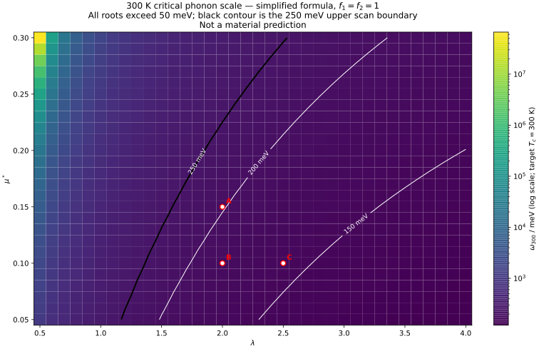

# 300 K 临界流形：解析求根与独立网格复核

> 本报告只研究稿件所用简化 Allen–Dynes/McMillan 公式，令 $f_1=f_2=1$；它不是材料级预测，也不构成 DFT、EPW 或 Eliashberg 计算。

## 1. 公式与单位

$$D=\lambda-\mu^*(1+0.62\lambda),\qquad E=1.04(1+\lambda)/D.$$

当 $D>0$ 时，$T_c=(11.6\,\omega_{\log}/1.20)e^{-E}$，$\omega_{300}=(360/11.6)e^E$ meV。$D\le0$ 时登记为 `nonpositive_denominator`，不返回伪造温度。

## 2. 数值锚点

| λ | μ* | 输入声子 / meV | Tc / K | ω300 / meV |
|--:|--:|--:|--:|--:|
| 2.0 | 0.15 | 100 | 148.24313461676417 | 202.37024856196908 |
| 2.0 | 0.10 | 100 | 166.85029454929392 | 179.80190014670225 |
| 2.5 | 0.10 | 140 | 267.4533390338644 | 157.03673826514486 |

稿件自行定义的 Coulomb 条件上界为 $\mu_{c,\mathrm{manuscript}}^*(2)=0.3$，不是约 0.15；它不是 Allen–Dynes 分母为零的阈值，后者在 $\lambda=2$ 时约为 0.892857。这些数值直接反驳‘严格内部组合必然超过 300 K’的命题，但不否定具体材料或完整强耦合理论。

## 3. 临界图



**图件插入顺序：第 1 幅，也是本报告唯一主图，置于公式与数值锚点之后、分类统计之前。** A、B、C 对应上表三组参数；黑色 250 meV 等值线（全部根高于 50 meV）是扫描窗上界。

## 4. 全网格复核

解析根共 **936** 组，直接网格共 **38,376** 点。根状态计数为 `{'above_scan': 340, 'within_scan': 596}`，网格分类计数为 `{'at_or_above_300K': 9296, 'below_300K': 29080}`。

`grid_class_disagreements = 0`。所有根均要求代回误差小于 $10^{-8}$ K，所有有效点均要求有限且非 NaN。

机读证据：`results.json`、`results.csv`、`grid_points.csv`。图由解析根绘制，网格只作独立复核，不用插值制造临界线。

## 5. 结论、边界与后续

本项目给出的是‘达到 300 K 需要多大简化声子尺度’的条件图，而不是材料级的室温超导必然性结论。全域最小根为 120.81020151475772 meV（λ=4.0，μ*=0.05），最大根为 66621518.616509594 meV（λ=0.5，μ*=0.3）。区间外根不解释为不存在。

真实 $\alpha^2F$ 的 Eliashberg 对照、$\eta\to\mu^*_{\mathrm{eff}}$ 映射证明或否证、以及反例优先的 Lean 形式化，均需另立验收标准。

## 6. 可复现命令

```bash
python critical_manifold.py
python test_critical_manifold.py -v
python render_report.py
python test_render_report.py -v
```

实际退出码、关键输出及 Word 外部验收记录见 `run.log` 与 `word-qa/report.json`。
